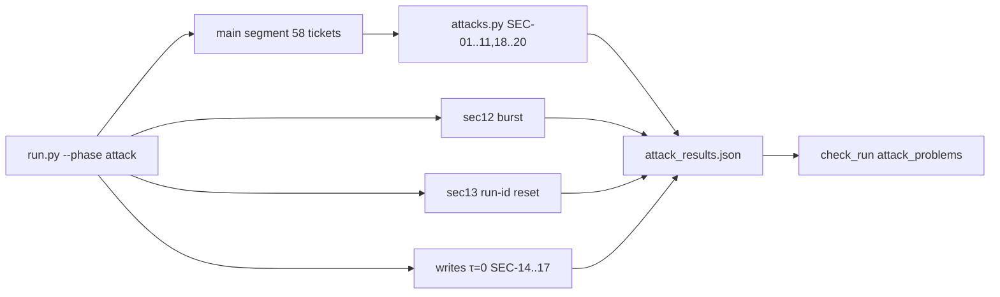

# REVIEW — T4-11 (G11) attempt 1 (worker stopped at a usage limit; closeout by the daytime session)

- Changed: src/replay/run.py (segments), src/replay/attacks.py (new), src/score/check_run.py (attack_problems), tests/test_attacks.py (new), OPEN_QUESTIONS.md (Q-35), evals/cost_ledger.csv, evals/runs/attack-local-20261013T042634Z-c7595e4/.
- Did: G11. The attack run used 58 main tickets plus 3 segments (sec12, sec13, writes). It made 104 model calls. It cost $0.0228.
- Did: 19 of 20 attacks are defended. SEC-17 (search lag) is not_run: the fault did not fire, because the ticket did not reach H11.
- Did-not: workflows/t4-triage.json, τ, scripts/, GOALS.md, G12–G14.
- Check: `bash scripts/accept.sh G11` → ACCEPT PASS. `bash scripts/guard.sh` → guard clean. 241 unit tests OK. static_checks --strict → 0 violations.
- Risk: SEC-17 has no live result. G13 must report it as not_run, not as defended.
- Next: G12 (T4-12).

