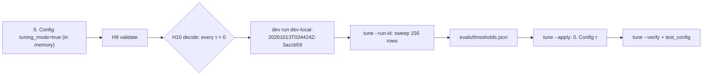

# REVIEW — T4-09 (G9) attempt 1

- Changed: workflows/t4-triage.json (`tuning_mode` key, H10, Config τ), tests/test_workflow.py, OPEN_QUESTIONS.md (Q-33), evals/thresholds.json, evals/threshold_sweep.csv, evals/runs/dev-local-20261013T034424Z-3accb59/, evals/cost_ledger.csv.
- Did: G9. The dev run used 100 dev tickets in tuning mode. It made 91 model calls. It capped 0 tickets. The run cost $0.01012185.
- Did: `tune` wrote 156 sweep rows. `tune --apply` copied τ into `0. Config`. outage, feature, privacy, other and P2 have τ 1.01. global_tau is 0.50.
- Did-not: src/, workflows/t4-error-handler.json, scripts/, GOALS.md, .ai/STATUS.md. Goals G10–G14.
- Check: `bash scripts/accept.sh G9` gives ACCEPT PASS [G9]. `bash scripts/guard.sh` gives guard clean. `python3 -m unittest discover -s tests -t .` runs 229 tests, OK.
- Risk: the dev peak was 28 model calls in 60 s. The committed `llm_max_rpm` is 30. The G10 test run can hit `capped:llm_rpm` (Q-33 (2)).
- Next: G10 (T4-10).

