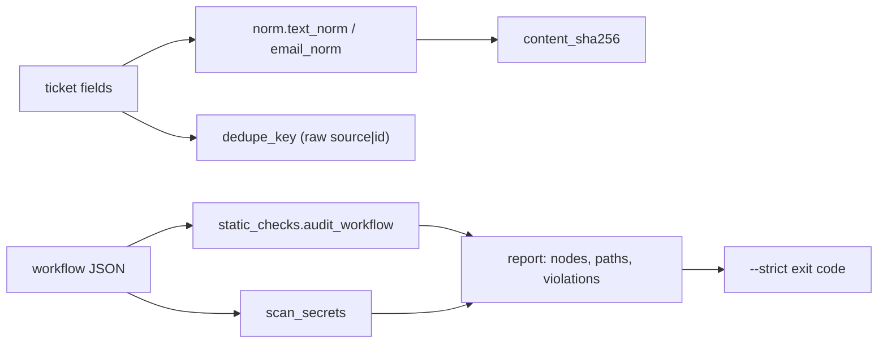

# REVIEW — T4-01 (G1) attempt 1

- Changed: src/__init__.py, src/common/__init__.py, src/common/norm.py, src/checks/__init__.py, src/checks/static_checks.py, tests/__init__.py, tests/test_norm.py, tests/test_static_checks.py, OPEN_QUESTIONS.md (Q-19, Q-20, Q-21).
- Did: G1. norm.py has text_norm, email_norm, dedupe_key, content_sha256. static_checks.py is the T2 port plus allowed hosts, no $env, Jira create without retry, and a Jira/Slack path report.
- Did-not: evals/, workflows/, scripts/, GOALS.md, .ai/STATUS.md. Goals G2–G14.
- Check: none. The Bash tool was denied in this run. I did not run unittest, compileall, accept.sh G1 or guard.sh. I did not run git status.
- Risk: the tests have not run. The loop's accept.sh G1 and guard.sh run decide DONE (OPEN_QUESTIONS Q-21).
- Next: G2 (T4-02).

