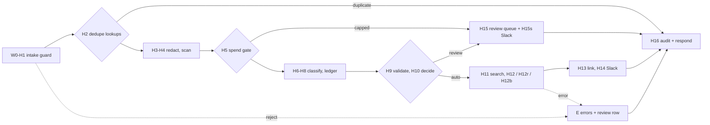

# REVIEW — T4-08 (G8) attempt 1

- Changed: workflows/t4-triage.json, tests/test_workflow.py, src/score/check_run.py, tests/test_check_run.py, OPEN_QUESTIONS.md (Q-32), evals/runs/smoke-local-20261013T032636Z-88604b7/, evals/runs/smoke-local-20261013T032958Z-88604b7/, evals/cost_ledger.csv.
- Did: G8. The workflow has 47 nodes. It adds H2, H5, H9, H10 thresholds, H11, H12r, H12b, H14, H15, H15s and the E review path. The smoke run used 12 dev tickets, 4 forced faults and passes AB. It made 9 model calls. Pass B made 0 model calls and 0 Jira issues. Each fault gave an errors row or a reconcile link. The run cost $0.0010308.
- Did: the first smoke run showed that n8n `first()` can read the empty error branch. Audit `pii_counts` was empty. The fix is `first(0)`. A test and a check_run rule stop it (Q-32 (7)).
- Did-not: workflows/t4-error-handler.json, src/replay/, src/sink/, src/js/, scripts/, GOALS.md, .ai/STATUS.md. Goals G9–G14.
- Check: `bash scripts/accept.sh G8` gives ACCEPT PASS [G8] (46 workflow tests OK, check_run ok). `bash scripts/guard.sh` gives guard clean. `python3 -m unittest discover -s tests -t .` runs 228 tests, OK.
- Risk: real Slack sends HTTP 200 `ok:false` on an error. H14 and H15s then set `notify_ok = 0` but write no errors row.
- Next: G9 (T4-09).

