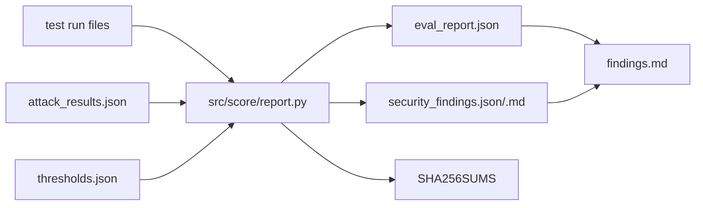

- Changed: `src/score/report.py`, `tests/test_score.py`, `OPEN_QUESTIONS.md`, `evals/eval_report.json`, `evals/SHA256SUMS`, `evals/security_findings.json`, `evals/security_findings.md`, `evals/findings.md`.
- Did: G13. The report generator wrote the eval report and the security table. The table has 20 rows with OWASP IDs. `findings.md` has the HARNESS_SPEC §6 headings.
- Did-not: `evals/runs/*`, workflows, τ, `scripts/`, `README.md`, G14.
- Check: `bash scripts/accept.sh G13` gave ACCEPT PASS. `bash scripts/guard.sh` gave guard clean. The unit tests gave 242 OK.
- Risk: The global τ beat the per-class τ on test. ADR-001 has no support from this run (Q-37 (4)).
- Next: G14.

