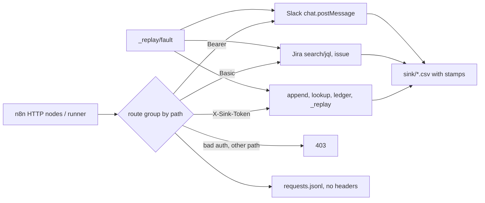

# REVIEW — T4-05 (G5) attempt 1

- Changed: src/sink/__init__.py, src/sink/server.py, tests/test_sink.py; OPEN_QUESTIONS.md (Q-29).
- Did: G5. One port serves the sink tables (X-Sink-Token), the Jira v3 subset (Basic) and Slack chat.postMessage (Bearer). The server refuses to start without the four secret values. The five faults and every 403 path have a test. requests.jsonl keeps Jira, Slack and LLM-mirror bodies and drops all headers.
- Did-not: src/score/, src/common/, scripts/, GOALS.md, .ai/STATUS.md, evals/, workflows/. Goals G6–G14. No live sink on port 8790 was started.
- Check: `bash scripts/accept.sh G5` gives ACCEPT PASS [G5] (26 tests OK). `bash scripts/guard.sh` gives guard clean. `python3 -m unittest discover -s tests -t .` runs 164 tests, OK.
- Risk: status codes differ from real Jira and Slack (403 for a bad credential; Slack errors are not HTTP 200), so G8 error branches fit the sandbox only (Q-29 (1)).
- Next: G6 (T4-06).

