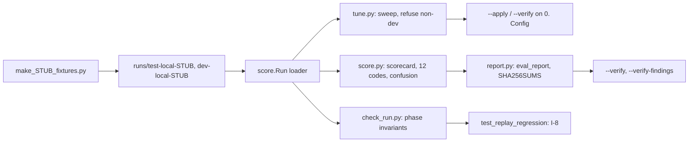

# REVIEW — T4-03 (G3) attempt 1

- Changed: src/score/__init__.py, score.py, tune.py, check_run.py, report.py; tests/test_score.py, test_tune.py, test_check_run.py, test_replay_regression.py; tests/fixtures/stub_run/**; OPEN_QUESTIONS.md (Q-25, Q-26, Q-27).
- Did: G3. The scorer, tuner, run checker and report generator judge the STUB runs. Every STUB fixture file has STUB in its name or first line.
- Did-not: workflows/, scripts/, GOALS.md, .ai/STATUS.md, src/common/, evals/. Goals G4–G14.
- Check: `bash scripts/accept.sh G3` gives ACCEPT PASS [G3]. `bash scripts/guard.sh` gives guard clean. `python3 -m unittest discover -s tests -t .` runs 118 tests, OK.
- Risk: G5 and G6 must write the run-file contract in Q-25. G8 must use the reason prefixes in Q-26 (6). The owner must answer Q-25 and Q-26.
- Next: G4 (T4-04).

