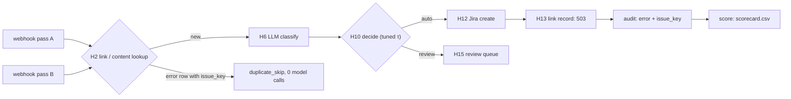

# REVIEW — T4-10 (G10) attempt 1

- Changed: workflows/t4-triage.json (H2 Content Lookup, H2 Dedupe Check, E comment), src/score/score.py (`read_csv`), tests/test_workflow.py, tests/test_score.py, OPEN_QUESTIONS.md (Q-34), evals/scorecard.csv, evals/confusion_category.csv, evals/confusion_priority.csv, evals/cost_ledger.csv, evals/runs/test-local-20261013T040225Z-0814c13/.
- Did: G10. The test run used 100 test tickets in passes AB. Pass A made 93 model calls. Pass B made 0 model calls and 0 issues. The run cost $0.0105318.
- Did: H2 skips an `error` audit row with an issue key. t4-075 was `error` SUP-9 in pass A and `duplicate_skip` SUP-9 in pass B.
- Did-not: τ values, src/sink/, src/replay/, workflows/t4-error-handler.json, scripts/, GOALS.md, .ai/STATUS.md. Goals G11–G14.
- Check: `bash scripts/accept.sh G10` gives ACCEPT PASS [G10]. `bash scripts/guard.sh` gives guard clean. `python3 -m unittest discover -s tests -t .` runs 232 tests, OK.
- Risk: 72 of 100 pass-A tickets went to review. 21 gold P3 tickets were predicted P2. The peak was 37 model calls in 60 s against a committed limit of 30 (Q-34 (3)).
- Next: G11 (T4-11).

