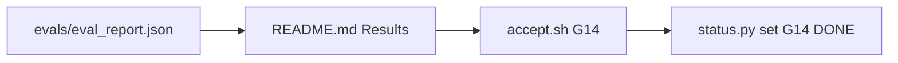

- Changed: README.md, .ai/STATUS.md, .ai/REVIEW.md, .ai/HANDOFF.md.
- Did: G14. The README states the test results from evals/eval_report.json. The README has 200 words or fewer.
- Did-not: src/, workflows/, evals/, GOALS.md. G1–G13 stay as committed.
- Check: `bash scripts/accept.sh G14` → ACCEPT PASS. `python3 -m unittest discover -s tests -t .` → 242 tests OK.
- Risk: Auto-route precision is 0.85. The target is 0.95. The README states this breach.
- Next: none in GOALS.md. Close plan docs/plans/2026-10-14_T4_CLOSE_PLAN.md §4 (real Jira and Slack demo).

