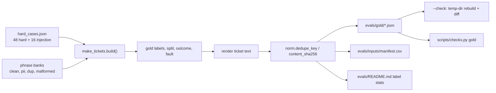

# REVIEW — T4-02 (G2) attempt 1

- Changed: src/fixtures/__init__.py, src/fixtures/make_tickets.py, src/fixtures/hard_cases.json, evals/gold/t4-001…t4-200.json, evals/inputs/manifest.csv, evals/README.md, tests/test_fixtures.py, OPEN_QUESTIONS.md (Q-22, Q-23, Q-24).
- Did: G2. The generator writes 200 gold files from seed 20261012. Gold comes first and the ticket text comes from gold. A rebuild is byte-identical.
- Did-not: workflows/, scripts/, GOALS.md, .ai/STATUS.md, src/common/. Goals G3–G14.
- Check: `bash scripts/accept.sh G2` gives ACCEPT PASS [G2]. `bash scripts/guard.sh` gives guard clean. `python3 -m unittest discover -s tests -t .` runs 57 tests, OK.
- Risk: the labels are not reviewed by a person. The owner must spot-check 30 gold files before publication (HARNESS_SPEC §1.4). Q-22 and Q-23 need an owner answer.
- Next: G3 (T4-03).

