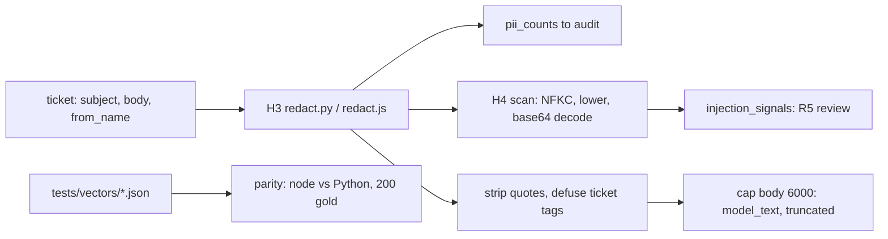

# REVIEW — T4-04 (G4) attempt 1

- Changed: src/common/redact.py, src/common/inject.py, src/js/redact.js, src/js/inject.js; tests/test_redact.py, tests/test_inject.py, tests/vectors/redact_vectors.json, tests/vectors/inject_vectors.json; OPEN_QUESTIONS.md (Q-28).
- Did: G4. Redaction removes all 37 planted PII values in 200 gold tickets. The scan flags 8 of 8 dev injection tickets and 0 of 76 dev clean/hard tickets. The JS output equals the Python output on all 200 gold tickets.
- Did-not: src/score/, scripts/, GOALS.md, .ai/STATUS.md, evals/, workflows/. Goals G5–G14. The inject audit was not run on the test split.
- Check: `bash scripts/accept.sh G4` gives ACCEPT PASS [G4]. `bash scripts/guard.sh` gives guard clean. `python3 -m unittest discover -s tests -t .` runs 138 tests, OK.
- Risk: the worker saw the 8 test-split injection tickets, so the G11 test recall is not fully blind (Q-28 (2)). The port source input_security.py was not read (Q-28 (1)).
- Next: G5 (T4-05).

