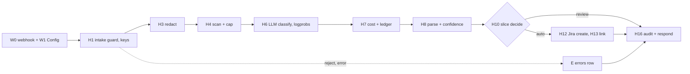

# REVIEW — T4-07 (G7) attempt 1

- Changed: workflows/t4-triage.json, workflows/t4-error-handler.json, src/js/norm.js, src/js/confidence.js, tests/test_workflow.py, OPEN_QUESTIONS.md (Q-2 result, Q-30 note, Q-31), evals/runs/slice-local-20261012T225612Z-98461ef/, evals/cost_ledger.csv.
- Did: G7. The slice path ran live on n8n 2.22.5 with gpt-4o-mini. 10 dev clean tickets gave 10 terminal audit rows. 8 tickets got a sandbox Jira issue. 2 tickets (privacy, other) went to review. 10 of 10 rows have `conf_source = logprobs`. The run cost $0.00113.
- Did-not: src/replay/, src/sink/, src/score/, src/common/, scripts/, GOALS.md, .ai/STATUS.md. Nodes H2, H5, H9, H11, H12r, H14, H15 (G8). Goals G8–G14.
- Check: `bash scripts/accept.sh G7` gives ACCEPT PASS [G7] (27 tests OK, check_run ok). `bash scripts/guard.sh` gives guard clean. `python3 -m unittest discover -s tests -t .` runs 204 tests, OK.
- Risk: the model gave P2 for 3 gold-P3 tickets (t4-007, t4-010, t4-017). The slice does not score priority; G9 measures it on dev.
- Next: G8 (T4-08).

