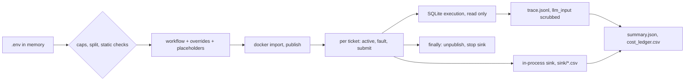

# REVIEW — T4-06 (G6) attempt 1

- Changed: src/replay/__init__.py, src/replay/run.py, tests/test_replay.py; OPEN_QUESTIONS.md (Q-30).
- Did: G6. `setup` imports five credentials from memory through docker stdin. `run` checks caps and static checks first. It substitutes placeholders in memory and publishes in `try`. It unpublishes in `finally`. It submits tickets one at a time to a fresh sink. It writes trace, summary and one cost-ledger row.
- Did-not: src/sink/, src/score/, src/common/, scripts/, GOALS.md, .ai/STATUS.md, evals/, workflows/. Goals G7–G14. No live n8n, docker or model call was made.
- Check: `bash scripts/accept.sh G6` gives ACCEPT PASS [G6] (13 tests OK). `bash scripts/guard.sh` gives guard clean. `python3 -m unittest discover -s tests -t .` runs 177 tests, OK.
- Risk: the docker CLI and SQLite paths ran against fakes only; G7 is the first live use (Q-30).
- Next: G7 (T4-07).

