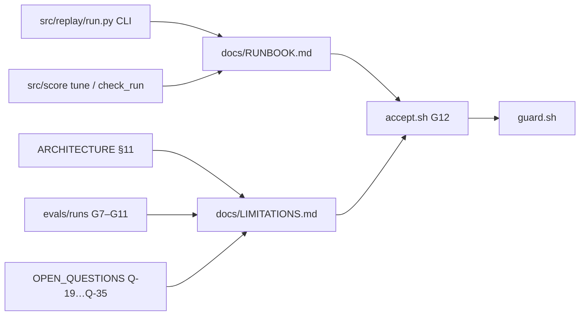

# REVIEW — T4-12 (G12) Runbook and limitations note

- Changed: `docs/RUNBOOK.md` (new), `docs/LIMITATIONS.md` (new), `OPEN_QUESTIONS.md` (Q-36), `.ai/HANDOFF.md`, `.ai/REVIEW.md`.
- Did: G12. The runbook has all ten headings and 580 words. The limitations note has 25 bullets, each with an evidence path.
- Did-not: no source, workflow, test, run folder or script changed. No live model call. G13 and G14 not started.
- Check: `bash scripts/accept.sh G12` → ACCEPT PASS. `bash scripts/guard.sh` → guard clean.
- Risk: the pruning settings and the hand-made `t4dk-` issue step are not tested by any run (Q-36).
- Next: G13 (T4-13).

