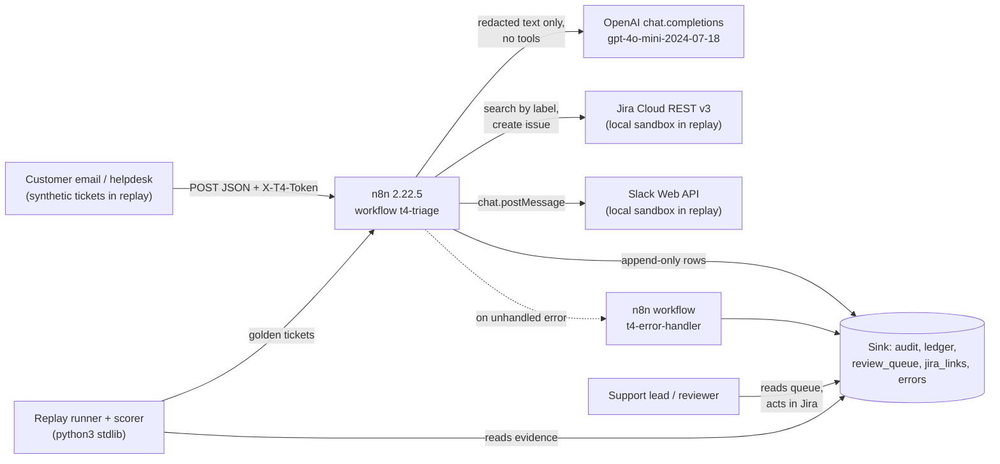

# Architecture — T4 Support Ticket Triage & Routing

Status: Proposed by architecture session 2026-10-12. Human acceptance pending (see `.ai/STATUS.md`, `OPEN_QUESTIONS.md`).
Authority: below `AGENTS.md` and accepted ADRs (`docs/adr/`); above `GOALS.md` and task notes.

T4 is a replayable support-ticket triage workflow on self-hosted n8n, built for a Head of Support / CS at a
20–200 person US/EU SaaS company. A ticket arrives by webhook (email is mapped to the same shape). PII is
redacted. A model classifies category, priority and urgency with a per-class confidence. Rules validate the
result. Per-class thresholds decide: create a Jira issue and post to Slack, or put the ticket in a human review
queue. Every ticket gets one audit row and one cost record.

It is not a product. Components: two n8n workflow JSON files, a local sink that also acts as a Jira-compatible
and Slack-compatible sandbox, a ticket generator, a replay runner, a scorer with a threshold tuner, and static
checks. Same shape as T2 (`../rescue-diagnostic-t2/docs/ARCHITECTURE.md`).

The seven METHOD stages are labels used in docs, traces, and audit rows (`stage` field):

```
intake → classify → validate → decide → act → approve → record
```

Security tier: **M** (internal tool, customer text in, writes to two business systems, no customer-facing output).

---

## 0. Invariants (agents must not break these)

| # | Invariant |
|---|---|
| I-1 | All tickets are synthetic English, US/EU SaaS context, labelled `synthetic: true` in gold. Emails use `example.com|org|net` only; phones use the `555-01xx` range; card numbers are published test numbers (e.g. `4111 1111 1111 1111`); no real person, company or customer data. |
| I-2 | Gold is written first; the ticket text is rendered from gold. Gold is never derived from, or edited toward, model output. Label fixes are dated in `evals/README.md` § Label changes. |
| I-3 | No secret in any file under `workflows/`, `evals/`, `src/`, `tests/`, `docs/`, `scripts/`, `logs/` (logs are scrubbed). Secrets live only in `.env` (gitignored) and the n8n credential store. |
| I-4 | Raw ticket text reaches only H1–H3 (intake). The model, Jira, Slack, the review queue and the audit log receive **redacted** text or derived labels only (ADR-004). |
| I-5 | The sink and the Jira/Slack sandboxes are append-only. No update or delete endpoint exists. |
| I-6 | Timestamps, token counts, costs, metrics and thresholds come from real executions. No hand-typed numbers in `evals/runs/`, `evals/*.csv`, `evals/thresholds.json`, or findings. |
| I-7 | Replay is sequential (concurrency 1). The runner never submits ticket N+1 before ticket N's execution has finished or timed out. |
| I-8 | A replay (pass B) of the same tickets against a sandbox that already holds pass A creates **zero** new Jira issues. Across all passes, every `dedupe_key` has at most one Jira issue. |
| I-9 | Thresholds are tuned on the `dev` split only. The `test` split is scored once per workflow version and never used for tuning prompts, rules or thresholds. |
| I-10 | Workflow JSON is target-agnostic: no `$env`, no hostnames, no tokens. Placeholders (`__SINK_BASE_URL__`, `__JIRA_BASE_URL__`, `__SLACK_BASE_URL__`, `__WEBHOOK_PATH__`) are substituted in memory at import (T2 §1.1 pattern). |
| I-11 | The classify call has **no tools**, and its output is limited to three enum fields. No model-written free text reaches Jira or Slack. |
| I-12 | Docs, README and findings never use the four banned words listed in `AGENTS.md`. Residual risk is always stated. |

---

## 1. Context



Trust boundaries: (1) ticket text is untrusted from the moment it enters H1; (2) the model is an untrusted
transformer — its output is data that rules check before anything acts on it; (3) Jira and Slack credentials are
held by n8n only and scoped to one project / one bot.

Targets: local Docker n8n `n8nio/n8n:2.22.5`, container name `n8n` (same pin and container as T2). No online
target. The sink runs on the host at `http://host.docker.internal:8790` (8787 and 8788 were used by T2).

---

## 2. Repository layout (target state)

Files marked *(Gn)* are created by that goal in `GOALS.md`. Nothing else is added without an ADR or a line in
`OPEN_QUESTIONS.md`.

```
support-triage-t4/
├── AGENTS.md  CLAUDE.md  README.md  THIN-LEDGER-v0.1.md
├── GOALS.md  HANDOFF.md  OPEN_QUESTIONS.md  RUN_OVERNIGHT.md  overnight.conf
├── .env.example  .gitignore
├── docs/ARCHITECTURE.md  HARNESS_SPEC.md  SECURITY_CONTROLS.md  DECISIONS.md  adr/ADR-00N-*.md
├── docs/RUNBOOK.md  docs/LIMITATIONS.md                   (G12)
├── .ai/STATUS.md  HANDOFF.md  ROUTING.md  REVIEW.md
├── specs/t4-triage/spec.md
├── scripts/  preflight.sh overnight.sh accept.sh guard.sh checks.py status.py morning_report.py init_env.py
│             claude-overnight-settings.json            (protected: the overnight worker cannot edit these)
├── src/
│   ├── common/norm.py        (G1)  text normalisation, dedupe/content keys
│   ├── common/redact.py      (G4)  reference PII redactor (Python); JS twin in src/js/redact.js
│   ├── common/inject.py      (G4)  reference injection scanner; JS twin in src/js/inject.js
│   ├── js/                   (G4)  JS embedded in Code nodes; tests run it under `node`
│   ├── checks/static_checks.py (G1) secret grep + workflow audit (ported from T2)
│   ├── fixtures/make_tickets.py (G2) deterministic golden-set generator
│   ├── fixtures/hard_cases.json (G2) hand-authored hard tickets (synthetic)
│   ├── sink/server.py        (G5)  append-only sink + Jira v3 subset + Slack chat.postMessage sandbox
│   ├── replay/run.py         (G6)  setup / run / replay (ported LocalN8n from T2)
│   ├── replay/attacks.py     (G11) SEC-01…SEC-20 driver (burst, wrong token, cap overrides)
│   ├── score/score.py        (G3)  scorecard, per-class metrics, confusion, failure codes
│   ├── score/tune.py         (G3)  per-class threshold sweep (dev split only)
│   ├── score/check_run.py    (G3)  per-phase run invariants used by acceptance (G7–G11)
│   └── score/report.py       (G3)  eval_report.json + SHA256SUMS
├── workflows/t4-triage.json  t4-error-handler.json        (G7, G8)
├── tests/                    unittest; tests/fixtures/stub_run/ labelled STUB; tests/vectors/ (G4)
├── logs/                     overnight logs (gitignored)
└── evals/
    ├── README.md
    ├── inputs/manifest.csv   gold/<input_id>.json         (G2)
    ├── runs/<run_id>/…                                    (G7–G11)
    ├── thresholds.json  threshold_sweep.csv               (G9)
    ├── scorecard.csv  confusion_*.csv  cost_ledger.csv    (G10)
    ├── eval_report.json  SHA256SUMS                       (G13, generated)
    ├── security_findings.json  security_findings.md       (G13)
    └── findings.md                                        (G13)
```

Dependency direction: `score`, `fixtures`, `replay` → `common`. `sink` imports nothing from the repo. Workflows
talk to sink, Jira and Slack over HTTP only. Stack: Python ≥ 3.9 stdlib only (system `python3` 3.9.6), node (already
installed) only to run `src/js/*.js` in tests. No pip, no npm.

---

## 3. Stage-by-stage design with controls

Control IDs (`C-n`) are referenced by `docs/SECURITY_CONTROLS.md`.

### 3.1 Intake (H1–H4)
| Control | What |
|---|---|
| C-1 | Webhook Header Auth (`X-T4-Token`, credential `t4-webhook-auth`); wrong token → 403 before any node runs. |
| C-2 | Size and type limits: body ≤ `max_body_chars` (20,000), subject ≤ 300, ≤ 10 attachments, attachment *metadata only* (name, type, bytes) — no binary is read; types outside `allowed_attachment_types` are recorded, never opened. Over limit → `rejected` with an error row and a review-queue row (ADR-002). |
| C-3 | Required fields: `source`, `source_message_id`, `from_email`, `subject` or `body_text`. Missing → `rejected`. |
| C-4 | Keys computed on raw input (never stored raw): `content_sha256 = sha256(norm(from_email)|norm(subject)|norm(body))`, `dedupe_key = sha256(source|source_message_id)[:20]`. |
| C-5 | PII redaction **before** the model and before any write (ADR-004): emails, phones, card numbers (Luhn-checked), IBANs, US SSNs, IPv4, URLs with query strings, and the sender's display name. Typed placeholders `[EMAIL_1]`, `[PHONE_1]`… Counts by type go to audit; values go nowhere. |
| C-6 | Injection scan on redacted text (ported from `RAG_ENTERPRISE_LANGGRAPH_APP/.../input_security.py`): role override, system-prompt extraction, tool/credential exfiltration, base64-decoded variants, Slack mass-mention tokens (`<!channel>`, `@here`). A hit does not block: it sets `injection_signals` and forces review in Decide. |
| C-7 | Model text cap: quoted reply history (`>` lines, `On … wrote:`) is stripped, then text is capped at `max_model_chars` (6,000). `truncated=1` is recorded. |

### 3.2 Classify (H5–H8)
| Control | What |
|---|---|
| C-8 | Spend gate before the call: `usd_today + est_usd > daily_usd_cap` or `usd_run + est_usd > run_usd_cap` or `calls_last_60s ≥ llm_max_rpm` → no call; ticket goes to review with `capped=1` (ADR-007). |
| C-9 | Schema-bound output: `response_format: json_schema, strict: true`, three enum fields only (§6.2). `max_tokens` 60, `temperature` 0, `logprobs: true`, `top_logprobs: 5`. **No tools.** Ticket text inside `<ticket>…</ticket>` and declared untrusted data. |
| C-10 | Per-class confidence from token logprobs, renormalised over the enum's first tokens (ADR-005). No logprobs → confidence 0 → review (fail closed). |
| C-11 | LLM HTTP node: timeout 30 s, `retryOnFail` maxTries 2 (one retry), `onError: continueErrorOutput` → error row + review. No second model is tried (ADR-005). |
| C-12 | Ledger row per call (tokens in/out, usd, UTC day) written before Validate. |

### 3.3 Validate (H9)
| Control | What |
|---|---|
| C-13 | Parse and enum check; any failure → `schema_miss` → review. |
| C-14 | Cross-checks (each failure adds a reason, any reason → review): R1 `outage` ⇒ priority ∈ {P1, P2}; R2 `other` ⇒ priority ≠ P1; R3 urgency `high` ⇒ priority ≠ P4; R4 deterministic privacy keywords (GDPR, CCPA, "delete my data", "data subject", "right to access") present but category ≠ `privacy` → review; R5 `injection_signals` non-empty; R6 `truncated=1` and category ∈ {outage, privacy}. |

### 3.4 Decide (H10)
| Control | What |
|---|---|
| C-15 | Per-class thresholds (ADR-001) from `0. Config`, copied from `evals/thresholds.json`: auto-route iff `conf_category ≥ τ_cat[category]` **and** `conf_priority ≥ τ_pri[priority]` **and** no validation reason **and** category ∉ `always_review` (`privacy`, `other`). |
| C-16 | Everything else goes to the human queue with its reasons. The queue is a designed outcome, measured as "% routed to human" (ADR-002). |

### 3.5 Act (H11–H14)
| Control | What |
|---|---|
| C-17 | Least-privilege credentials: Jira bot user with Browse + Create Issues on project `SUP` only (`t4-jira`, HTTP Basic: email + API token); Slack bot with `chat:write` only, invited to two channels (`t4-slack`, Bearer). The sandbox rejects any other project, issue type, method or path (403) and logs it. |
| C-18 | Idempotent create (ADR-006): (1) sink lookup `jira_links?dedupe_key=` → hit = `duplicate_skip`; (2) content lookup `audit?content_sha256=&status=auto_routed|review` → hit = `duplicate_skip`; (3) Jira search `labels = "t4dk-<dedupe_key>"` → hit = record link, `duplicate_skip`; (4) create with that label; (5) on create error **never blind-retry**: search by label again (reconcile), create once more only if absent; (6) append `jira_links` row = commit marker. |
| C-19 | Jira fields are deterministic: summary = `[<category>] ` + redacted subject (≤ 120 chars); description (ADF) = redacted body (≤ 2,000 chars) + labels + confidences + `ticket_ref`. Priority mapped P1→Highest, P2→High, P3→Medium, P4→Low. No model-written text. |
| C-20 | Slack text is built from escaped fields (`&`→`&amp;`, `<`→`&lt;`, `>`→`&gt;`), so `<!channel>` and link markup cannot be produced; channel IDs come from Config only; `unfurl_links:false`. Slack failure is logged and non-fatal (the issue already exists). |
| C-21 | Rate and spend caps on act: at most `jira_max_creates_per_run` (150) creates per run_id; beyond → review with `capped=1`. |

### 3.6 Approve (H15)
| Control | What |
|---|---|
| C-22 | `review_queue` row (redacted text, predicted labels, confidences, reasons) + one Slack message to the review channel. No Jira issue is created for queued tickets in this build. A reviewer creates or closes the issue in Jira by hand (approval webhook is cut, `GOALS.md` § Cut). |
| C-23 | No customer-facing action exists (no auto-reply, no status email). Any future customer-facing action must go through Approve (ADR-002). |

### 3.7 Record (H16, E, error handler)
| Control | What |
|---|---|
| C-24 | Exactly one terminal `audit` row per ticket per pass: `status ∈ auto_routed | review | duplicate_skip | rejected | error`, with run_id, execution_id, labels, confidences, reasons, pii counts, issue_key, tokens, usd, duration. |
| C-25 | `errors` row for every error branch; workflow-level Error Workflow `t4-error-handler` catches anything else. |
| C-26 | Replayable: runner records `trace.jsonl`, sink `requests.jsonl` (headers dropped, bodies kept for Jira/Slack/LLM-input leak checks), `summary.json`, and one `cost_ledger.csv` row per run. |

---

## 4. n8n node-by-node breakdown — `workflows/t4-triage.json`

Every external HTTP node: `onError: continueErrorOutput`, `options.timeout` set, `retryOnFail` ≤ 3 tries (static
check, `--strict`). `E(code)` = append `errors` row → append review_queue row where a ticket exists → terminal audit
row → respond. `R(status)` = terminal audit row → respond.

| # | Node (type) | Stage | Purpose | Input → Output | Error path |
|---|---|---|---|---|---|
| W0 | `0. Webhook — Ticket Intake` (webhook 2, POST, headerAuth `t4-webhook-auth`, path `__WEBHOOK_PATH__`, responseMode lastNode) | intake | receive ticket JSON + `X-Replay-Run-Id`, `X-Replay-Input-Id` | HTTP body → `{body, headers}` | auth fail → 403 from n8n (no execution) |
| W1 | `0. Config` (Set) | intake | all tunables §5.2, thresholds | – → config fields | – |
| H1 | `H1 Intake Guard` (Code) | intake | C-2, C-3; compute run_id (header or `day-<UTC date>`), input_ref, `dedupe_key`, `content_sha256` (crypto via Crypto node H1a) | raw ticket → `{ticket, keys, limits_ok}` | fail → `E(reject:intake)` |
| H2 | `H2 Dedupe Lookup` (HTTP GET sink `/lookup/jira_links?dedupe_key=` then `/lookup/audit?content_sha256=`) | intake | C-18 steps 1–2, before any model spend | keys → hit/miss | sink error → `E(error:sink)` |
| H3 | `H3 Redact` (Code, `src/js/redact.js`) | intake | C-5; drop raw text from the item after this node | ticket → `{redacted_subject, redacted_body, pii_counts}` | throw → `E(error:redact)` (fail closed: no model call) |
| H4 | `H4 Injection Scan + Cap` (Code, `src/js/inject.js`) | intake | C-6, C-7 | redacted → `{model_text, injection_signals, truncated}` | throw → `E(error:scan)` |
| H5 | `H5 Spend Gate` (HTTP GET sink `/ledger/sum?day=`, `/ledger/sum?run_id=`, `/ledger/count?since_s=60`) + IF | classify | C-8 | est_usd → pass/cap | cap → review `capped=1`; sink error → `E(error:sink)` |
| H6 | `H6 LLM Classify` (HTTP POST `https://api.openai.com/v1/chat/completions`, credential `t4-llm` Header Auth Bearer) | classify | C-9, C-11; body references **only** `$json.model_text` and Config | model_text → completion with logprobs | → `E(error:llm)` → review |
| H7 | `H7 Ledger Append` (HTTP POST sink `/append/ledger`) | classify | C-12 | usage → ledger row | → `E(error:sink)` |
| H8 | `H8 Parse + Confidence` (Code) | classify | C-10, C-13: parse enums, compute `conf_category`, `conf_priority`, `conf_source` | completion → labels + confidences | parse fail → reason `schema_miss` (continues to H10 → review) |
| H9 | `H9 Validate` (Code) | validate | C-14 rules R1–R6 | labels → `reasons[]` | – |
| H10 | `H10 Decide` (Switch) | decide | C-15, C-16 | labels, conf, reasons → `auto` / `review` | – |
| H11 | `H11 Jira Search` (HTTP GET `__JIRA_BASE_URL__/rest/api/3/search/jql`, credential `t4-jira`) | act | C-18 step 3 | label → issue key or none | → `E(error:jira)` → review |
| H12 | `H12 Jira Create` (HTTP POST `/rest/api/3/issue`, **retryOnFail false**) | act | C-18 step 4, C-19, C-21 | fields → `{key}` | → H12r |
| H12r | `H12r Reconcile` (HTTP GET search by label, then IF; at most one re-create via `H12b Jira Create (retry once)`) | act | C-18 step 5 | label → key or none | second failure → `E(error:jira)` → review |
| H13 | `H13 Link Record` (HTTP POST sink `/append/jira_links`) | act | C-18 step 6 — commit marker | key → row | → `E(error:sink)` (issue exists; next replay finds it via H11) |
| H14 | `H14 Slack Notify` (HTTP POST `__SLACK_BASE_URL__/api/chat.postMessage`, credential `t4-slack`) | act | C-20 | escaped text → `ok` | error row, status stays `auto_routed`, audit `notify_ok=0` |
| H15 | `H15 Review Queue` (HTTP POST sink `/append/review_queue`) + `H15s Slack Review Post` | approve | C-22 | redacted + labels + reasons | → `E(error:sink)` |
| H16 | `H16 Audit` (HTTP POST sink `/append/audit`) + `H16r Respond` | record | C-24 | terminal status → 200 `{ticket_ref, status}` | → error handler |
| EH | `t4-error-handler.json`: Error Trigger → HTTP POST sink `/append/errors` | record | C-25 | n8n error → row | – |

The thin slice (G7) is W0 → W1 → H1 → H3 → H4 → H6 → H7 → H8 → (fixed decision) → H12 → H13 → H16. G8 adds H2,
H5, H9, H10 thresholds, H11, H12r, H14, H15, EH.

**Email adapter (documented, not replayed):** an n8n IMAP Email Trigger maps `messageId → source_message_id`,
`from.value[0].address → from_email`, `subject`, `text → body_text`, attachments metadata, then calls the same
graph from H1. Same as T2's Sheets adapter note.

---

## 5. Configuration

### 5.1 `.env` (gitignored; `.env.example` lists names only)
| Name | Used by |
|---|---|
| `T4_TARGET` (`local`) | runner |
| `N8N_BASE_URL` (`http://localhost:5678`) | runner |
| `N8N_CONTAINER` (`n8n`) | runner (docker exec) |
| `OPENAI_API_KEY` | runner `setup` → credential `t4-llm` (in memory) |
| `T4_WEBHOOK_TOKEN`, `T4_WEBHOOK_PATH` | runner header + placeholder; credential `t4-webhook-auth` |
| `SINK_TOKEN`, `SINK_PORT` (8790), `SINK_BASE_URL` | sink + credential `t4-sink-auth` |
| `JIRA_SANDBOX_EMAIL`, `JIRA_SANDBOX_API_TOKEN`, `JIRA_PROJECT_KEY` (`SUP`), `JIRA_BASE_URL` | sandbox auth + credential `t4-jira` |
| `SLACK_SANDBOX_BOT_TOKEN`, `SLACK_BASE_URL`, `SLACK_CHANNEL_TRIAGE`, `SLACK_CHANNEL_REVIEW` | sandbox auth + credential `t4-slack` |
| `LLM_PRICE_IN_PER_MTOK`, `LLM_PRICE_OUT_PER_MTOK` | runner + scorer; must equal `0. Config` |
| `RUN_USD_CAP`, `DAILY_USD_CAP`, `PROJECT_LLM_USD_CAP` | runner safety net; first two must equal `0. Config` |

### 5.2 `0. Config` node (committed, non-secret, buyer-readable)
`llm_model` (`gpt-4o-mini-2024-07-18`), `llm_price_in_per_mtok` / `_out_` (0.15 / 0.60, T2 Q-1), `run_usd_cap` (0.25),
`daily_usd_cap` (1.00), `llm_max_rpm` (30), `max_body_chars` (20000), `max_model_chars` (6000), `max_output_tokens` (60),
`allowed_attachment_types`, `jira_project_key` (`SUP`), `jira_issue_type` (`Task`), `jira_max_creates_per_run` (150),
`slack_channel_triage`, `slack_channel_review`, `always_review` (`["privacy","other"]`), `tau_category` {8 values},
`tau_priority` {4 values}. Before G9 all τ = 1.01 (everything to review) except the slice.

---

## 6. Data model

### 6.1 Ticket in (webhook body = gold `ticket` object)
```json
{"source": "email|webhook", "source_message_id": "<t4-001@mail.example.com>", "from_name": "Dana Whitfield",
 "from_email": "dana.whitfield@example.com", "subject": "…", "body_text": "…", "received_at": "2026-09-14T09:12:00Z",
 "attachments": [{"name": "screenshot.png", "type": "image/png", "bytes": 48213}]}
```

### 6.2 Classifier output (strict JSON schema; enum words chosen so each value starts with a distinct token)
```
category  ∈ billing | access | bug | outage | howto | feature | privacy | other
priority  ∈ critical | high | normal | low        (mapped to P1 | P2 | P3 | P4)
urgency   ∈ high | medium | low
```
Definitions and tie-break rules: `docs/HARNESS_SPEC.md` §2 (labelling guide). The prompt and the labelling guide use
the same definitions.

### 6.3 Sink tables (all rows stamped `sink_seq, sink_ts, replay_input_id, replay_pass`, T2 §4.2)
| Table | Columns |
|---|---|
| audit | run_id, input_ref, execution_id, stage, node, ok, status, dedupe_key, content_sha256, category, conf_category, priority, conf_priority, urgency, conf_source, reasons, pii_counts, injection_signals, truncated, issue_key, notify_ok, capped, tokens_in, tokens_out, usd, duration_ms |
| ledger | run_id, input_ref, day, model, tokens_in, tokens_out, usd |
| review_queue | run_id, dedupe_key, reasons, category, conf_category, priority, conf_priority, urgency, redacted_subject, redacted_body |
| jira_links | run_id, dedupe_key, issue_key, category, priority, created_via (`create|retry|search`) |
| errors | run_id, input_ref, stage, node, code, message |
| sandbox: jira_issues | key, project, issuetype, summary, description_text, labels, priority, created_seq |
| sandbox: slack_messages | channel, text, unfurl_links |

### 6.4 Gold file — see `docs/HARNESS_SPEC.md` §1.3.

---

## 7. Jira and Slack contract

**Jira (Cloud REST v3 subset — what the sandbox implements and what a real site must allow):**
- `GET /rest/api/3/search/jql?jql=labels%20%3D%20%22t4dk-<key>%22&fields=key&maxResults=2` → `{"issues":[{"key":"SUP-12"}]}`
- `POST /rest/api/3/issue` with `{"fields":{"project":{"key":"SUP"},"issuetype":{"name":"Task"},"summary":…,"description":<ADF doc>,"labels":["t4","t4dk-<key>","t4-cat-<category>"],"priority":{"name":"High"}}}` → `201 {"id","key","self"}`
- Auth: HTTP Basic (bot email + API token). Anything else → 403 (sandbox) and a request-log row.
- Sandbox fault modes (per ticket, from gold `fault`): `503` (no issue created), `commit_then_504` (issue created, response lost), `search_lag` (search hides issues younger than N requests).

**Slack (Web API subset):** `POST /api/chat.postMessage` Bearer bot token, JSON `{channel, text, unfurl_links:false, unfurl_media:false}` → `{"ok":true,"ts":…}`. Fault mode `503`.

Swapping to a real Jira Cloud sandbox site and a real Slack workspace = change `JIRA_BASE_URL` / `SLACK_BASE_URL`
and the two credentials; no node changes (ADR-003). Not done in this build.

---

## 8. Idempotency design (ADR-006)

- `dedupe_key` = first 20 hex of `sha256(source + "|" + source_message_id)` — catches webhook retries, email
  re-delivery, and replay pass B.
- `content_sha256` over normalised sender, subject and body — catches a customer re-sending the same text with a new
  message id. A follow-up with different text is a new ticket (semantic dedupe is out of scope; limitation).
- Order: sink link lookup → content lookup → Jira label search → create → reconcile on error → link row.
- The Jira label `t4dk-<dedupe_key>` makes Jira itself the second source of truth, so a lost response or a lost link
  row cannot cause a second issue on replay.
- Residual: lookup-then-create is not atomic (concurrent deliveries can both create); real Jira search has index lag
  (the `search_lag` fault shows the effect). Both go in findings.

---

## 9. Model choice and fallback (ADR-005)

- Primary: `gpt-4o-mini-2024-07-18` via `api.openai.com` — same model the owner approved and ran in T2 on 2026-10-12;
  supports strict JSON schema and token logprobs (logprobs are needed for per-class confidence; verified in G7, see
  `OPEN_QUESTIONS.md` Q-2).
- Fallback: **the human queue, not a second model.** A different model has different confidence calibration, so
  thresholds tuned on one model are not valid for another. A model change = new dev run + new thresholds + new test run.
- DeepSeek (T2 owner preference) is a documented manual swap only, with confidence from self-report → expect higher
  % routed to human.

---

## 10. Cost per 1,000 tickets (planning estimate — replaced by the measured ledger in G10)

Prices from T2 Q-1: $0.15 / 1M input tokens, $0.60 / 1M output tokens.

| Case | Input tokens / ticket | Output tokens / ticket | $ / ticket | $ / 1,000 tickets |
|---|---|---|---|---|
| Typical (prompt ≈ 700 + ticket ≈ 350) | ≈ 1,050 | ≈ 25 | ≈ 0.00017 | ≈ 0.17 |
| At cap (prompt 700 + 6,000 chars ≈ 1,500) | ≈ 2,200 | ≈ 25 | ≈ 0.00035 | ≈ 0.35 |
| Duplicates (skipped before the model) | 0 | 0 | 0 | 0 |

Not included: n8n hosting, Jira and Slack seats. The model is a small share of cost; the buyer's real cost is
reviewer minutes, which "% routed to human" measures.

---

## 11. What this design does NOT fix (restate in findings)

- An injection that reads as a normal ticket and pushes a plausible category passes every rule (C-6 is a pattern
  scan, not a classifier). Mitigation is limited to "no tools, three enums, deterministic Jira/Slack text".
- Redaction is pattern-based: free-text names other than the sender, street addresses, and order numbers are not
  removed. Measured by `pii_leak` on planted values only.
- Lookup-then-create race and Jira search index lag (§8).
- Thresholds are tuned on 100 synthetic dev tickets: small per-class samples, synthetic language. Expect drift on
  real tickets; re-tune on a labelled sample of real data before use.
- Single model run at temperature 0; no repeated-run calibration.
- The webhook token sits in n8n execution data (T2 R-3); prune executions or rotate.
